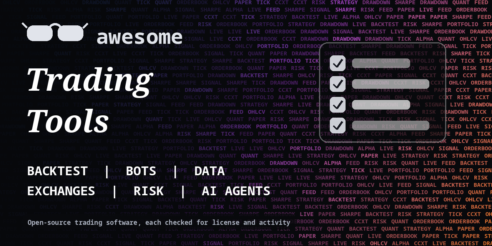

<h1 align="center">Awesome Trading Tools</h1>

> Open-source libraries, bots, backtesters, data tools and AI agents for trading stocks, futures, forex and crypto. Every entry shows its license.

> This list is a software index, not financial advice. Trading can lose all your money.

**Rules of this list:** every repo exists, is public, is not archived, states a license and has had a commit in the last year. One plain sentence each. Star counts and claims are the authors' own, we did not test every tool. Checked 2026-10-18. See [CONTRIBUTING.md](CONTRIBUTING.md).

## Contents

- [Trading bots and frameworks](#trading-bots-and-frameworks)
- [Backtesting and research](#backtesting-and-research)
- [Exchange and broker libraries](#exchange-and-broker-libraries)
- [Market data and downloaders](#market-data-and-downloaders)
- [Technical analysis and indicators](#technical-analysis-and-indicators)
- [Portfolio, risk and performance](#portfolio-risk-and-performance)
- [Machine learning and AI for trading](#machine-learning-and-ai-for-trading)
- [Research platforms and terminals](#research-platforms-and-terminals)
- [Crypto, DeFi and on-chain](#crypto-defi-and-on-chain)
- [How to choose](#how-to-choose)
- [Contributing](#contributing)

## Trading bots and frameworks

Run strategies live or on paper, with exchange connections built in.

- [coding-kitties/investing-algorithm-framework](https://github.com/coding-kitties/investing-algorithm-framework)  - Framework for quantitative trading. _(Apache-2.0)_
- [Drakkar-Software/OctoBot](https://github.com/Drakkar-Software/OctoBot)  - Free open source crypto trading bot to automate AI, Grid, DCA and TradingView strategies on Binance, Hyperliquid and 15+ exchanges. _(GPL-3.0)_
- [fabston/TradingView-Webhook-Bot](https://github.com/fabston/TradingView-Webhook-Bot)  - Forward TradingView alerts to Telegram, Discord, Slack and email. _(MIT)_
- [freqtrade/freqtrade](https://github.com/freqtrade/freqtrade)  - Free, open source crypto trading bot. _(GPL-3.0)_
- [freqtrade/freqtrade-strategies](https://github.com/freqtrade/freqtrade-strategies)  - Sample strategies for Freqtrade. For learning, not a promise of profit. _(GPL-3.0)_
- [Haehnchen/crypto-trading-bot](https://github.com/Haehnchen/crypto-trading-bot)  - Cryptocurrency trading bot in javascript for Bitfinex, Bitmex, Binance, Bybit. _(MIT)_
- [hummingbot/hummingbot](https://github.com/hummingbot/hummingbot)  - Open-source framework for market making and automated trading bots on crypto exchanges. _(Apache-2.0)_
- [iterativv/NostalgiaForInfinity](https://github.com/iterativv/NostalgiaForInfinity)  - Large community strategy for the Freqtrade bot. _(GPL-3.0)_
- [jesse-ai/jesse](https://github.com/jesse-ai/jesse)  - An advanced crypto trading bot written in Python. _(MIT)_
- [Lumiwealth/lumibot](https://github.com/Lumiwealth/lumibot)  - Python library for backtesting and live trading of stocks, options, crypto and futures with several brokers. _(GPL-3.0)_
- [nautechsystems/nautilus_trader](https://github.com/nautechsystems/nautilus_trader)  - Production-grade Rust-native trading engine with deterministic event-driven architecture. _(LGPL-3.0)_
- [QuantConnect/Lean](https://github.com/QuantConnect/Lean)  - Event-driven trading engine in C# and Python for research, backtesting and live trading. _(Apache-2.0)_
- [Superalgos/Superalgos](https://github.com/Superalgos/Superalgos)  - Free, open-source crypto trading bot, automated bitcoin / cryptocurrency trading software, algorithmic trading bots. _(Apache-2.0)_
- [vnpy/vnpy](https://github.com/vnpy/vnpy)  - Python framework for building quant trading systems, popular in Asian markets. _(MIT)_

## Backtesting and research

Test an idea on past data before you risk money.

- [cuemacro/finmarketpy](https://github.com/cuemacro/finmarketpy)  - Python library for backtesting trading strategies & analyzing financial markets (formerly pythalesians). _(Apache-2.0)_
- [fasiondog/hikyuu](https://github.com/fasiondog/hikyuu)  - An open-source, high-performance quantitative trading framework in C++/Python focused on strategy analysis. _(Apache-2.0)_
- [fbertram/TuringTrader](https://github.com/fbertram/TuringTrader)  - The Open-Source Backtesting Engine/ Trading Simulator by Bertram Enterprises. _(AGPL-3.0)_
- [kernc/backtesting.py](https://github.com/kernc/backtesting.py)  - Small Python library for backtesting trading strategies with a simple API. _(AGPL-3.0)_
- [nkaz001/hftbacktest](https://github.com/nkaz001/hftbacktest)  - Free, open source, a high frequency trading and market making backtesting and trading bot, which accounts for limit orders. _(MIT)_
- [pmorissette/bt](https://github.com/pmorissette/bt)  - Flexible Python backtesting framework for portfolio strategies. _(MIT)_
- [polakowo/vectorbt](https://github.com/polakowo/vectorbt)  - Fast Python library for testing many strategies at once with vectorized backtests. _(check repo)_
- [stefan-jansen/zipline-reloaded](https://github.com/stefan-jansen/zipline-reloaded)  - Maintained fork of the Zipline backtesting engine. _(Apache-2.0)_

## Exchange and broker libraries

Unified APIs for exchanges and brokers.

- [alpacahq/alpaca-py](https://github.com/alpacahq/alpaca-py)  - Official Python SDK for Alpaca stock and crypto trading and market data. _(Apache-2.0)_
- [ccxt/ccxt](https://github.com/ccxt/ccxt)  - Unified API for more than 100 crypto exchanges, in JavaScript, Python, PHP, C# and Go. _(MIT)_
- [ib-api-reloaded/ib_async](https://github.com/ib-api-reloaded/ib_async)  - Python framework for Interactive Brokers, successor to ib_insync. _(BSD-2-Clause)_
- [JKorf/Binance.Net](https://github.com/JKorf/Binance.Net)  - C#/.NET client library for the Binance.com cryptocurrency exchange REST and WebSocket APIs, supporting Spot and Futures trading. _(MIT)_
- [JKorf/CryptoExchange.Net](https://github.com/JKorf/CryptoExchange.Net)  - Base library for building clients for crypto exchange APIs in .NET. _(MIT)_
- [pmxt-dev/pmxt](https://github.com/pmxt-dev/pmxt)  - CCXT for prediction markets. PMXT is a unified API for trading on Polymarket, Kalshi, and more. _(MIT)_
- [sammchardy/python-binance](https://github.com/sammchardy/python-binance)  - Python wrapper for the Binance exchange REST and WebSocket APIs. _(MIT)_
- [tardis-dev/tardis-node](https://github.com/tardis-dev/tardis-node)  - Convenient access to tick-level real-time and historical cryptocurrency market data via Node.js. _(MPL-2.0)_

## Market data and downloaders

Prices, fundamentals, order books and on-chain data.

- [defeat-beta/defeatbeta-api](https://github.com/defeat-beta/defeatbeta-api)  - An open-source alternative to Yahoo Finance's market data APIs with higher reliability. _(Apache-2.0)_
- [JerBouma/FinanceDatabase](https://github.com/JerBouma/FinanceDatabase)  - Database of financial symbols and categories for equities, ETFs, funds and more. _(MIT)_
- [JerBouma/FinanceToolkit](https://github.com/JerBouma/FinanceToolkit)  - Transparent and Efficient Financial Analysis. _(MIT)_
- [openbq-org/OpenBB](https://github.com/openbq-org/OpenBB)  - Open data platform for analysts, quants and AI agents, with many data sources behind one interface. _(check repo)_
- [pydata/pandas-datareader](https://github.com/pydata/pandas-datareader)  - Pull remote data sources such as FRED into pandas. _(check repo)_
- [questdb/questdb](https://github.com/questdb/questdb)  - Fast open-source time-series database, often used for tick and market data. _(Apache-2.0)_
- [ranaroussi/yfinance](https://github.com/ranaroussi/yfinance)  - Download Yahoo Finance market data in Python. For personal use, check Yahoo's terms. _(Apache-2.0)_

## Technical analysis and indicators

Indicator libraries and charting.

- [bukosabino/ta](https://github.com/bukosabino/ta)  - Technical Analysis Library using Pandas and Numpy. _(MIT)_
- [cinar/indicator](https://github.com/cinar/indicator)  - High-performance technical analysis indicators and backtesting framework in Go. _(AGPL-3.0)_
- [TA-Lib/ta-lib](https://github.com/TA-Lib/ta-lib)  - Technical analysis library: indicators and candlestick patterns, batch and streaming, native in C, Rust, Java, C#. _(BSD-3-Clause)_
- [TA-Lib/ta-lib-python](https://github.com/TA-Lib/ta-lib-python)  - Python wrapper for TA-Lib. _(BSD-2-Clause)_
- [ta4j/ta4j](https://github.com/ta4j/ta4j)  - A Java library for technical analysis. _(check repo)_
- [tradingview/lightweight-charts](https://github.com/tradingview/lightweight-charts)  - Small, fast financial charts for the web from TradingView. _(Apache-2.0)_

## Portfolio, risk and performance

Optimize allocation and measure results.

- [cvxgrp/cvxportfolio](https://github.com/cvxgrp/cvxportfolio)  - Portfolio optimization and back-testing. _(GPL-3.0)_
- [dcajasn/Riskfolio-Lib](https://github.com/dcajasn/Riskfolio-Lib)  - Portfolio Optimization in Python. _(BSD-3-Clause)_
- [PyPortfolio/PyPortfolioOpt](https://github.com/PyPortfolio/PyPortfolioOpt)  - Financial portfolio optimization in python, including classical efficient frontier, Black-Litterman, Hierarchical Risk Parity. _(MIT)_
- [ranaroussi/quantstats](https://github.com/ranaroussi/quantstats)  - Portfolio analytics for quants: performance and risk statistics with tear sheets. _(Apache-2.0)_
- [skfolio/skfolio](https://github.com/skfolio/skfolio)  - Python library for portfolio optimization built on top of scikit-learn. _(BSD-3-Clause)_
- [stefan-jansen/pyfolio-reloaded](https://github.com/stefan-jansen/pyfolio-reloaded)  - Maintained fork of Pyfolio for performance and risk analysis of trading strategies. _(Apache-2.0)_

## Machine learning and AI for trading

Research code, models and LLM agents for markets. Results are not a promise of profit.

- [AI4Finance-Foundation/FinGPT](https://github.com/AI4Finance-Foundation/FinGPT)  - Open-source financial large language models and tools. _(MIT)_
- [AI4Finance-Foundation/FinRL](https://github.com/AI4Finance-Foundation/FinRL)  - Deep reinforcement learning library for automated trading research. _(MIT)_
- [asavinov/intelligent-trading-bot](https://github.com/asavinov/intelligent-trading-bot)  - Intelligent Trading Bot: Automatically generating signals and trading based on machine learning and feature engineering. _(MIT)_
- [je-suis-tm/quant-trading](https://github.com/je-suis-tm/quant-trading)  - Python quantitative trading strategies including VIX Calculator, Pattern Recognition, Commodity Trading Advisor, Monte Carlo. _(Apache-2.0)_
- [microsoft/qlib](https://github.com/microsoft/qlib)  - AI-oriented quant research platform from Microsoft, from data to backtests. _(MIT)_
- [stefan-jansen/machine-learning-for-trading](https://github.com/stefan-jansen/machine-learning-for-trading)  - Code for the book Machine Learning for Algorithmic Trading. _(MIT)_
- [TauricResearch/TradingAgents](https://github.com/TauricResearch/TradingAgents)  - Multi-agent LLM framework that simulates a trading firm. Research use. _(Apache-2.0)_
- [zvtvz/zvt](https://github.com/zvtvz/zvt)  - Modular quant framework. _(MIT)_

## Research platforms and terminals

Full desktop, web or terminal platforms for analysis.

- [AlexWan/OsEngine](https://github.com/AlexWan/OsEngine)  - Open Source algo trading platform. _(check repo)_
- [Fincept-Corporation/FinceptTerminal](https://github.com/Fincept-Corporation/FinceptTerminal)  - FinceptTerminal is a modern finance application offering advanced market analytics, investment research, and economic data tools. _(check repo)_
- [StockSharp/StockSharp](https://github.com/StockSharp/StockSharp)  - Algorithmic trading and quantitative trading open source platform to develop trading robots. _(check repo)_

## Crypto, DeFi and on-chain

Bots and tools that read or trade on-chain markets.

- [BowTiedDevil/degenbot](https://github.com/BowTiedDevil/degenbot)  - Building blocks for Uniswap (V2, V3, V4), Curve V1, Solidly V2, Balancer V2 & Aave V3 arbitrage. _(MIT)_

## How to choose

- **Paper trade first.** Run any bot on a demo account for weeks before you use real money.
- **Past results do not predict future results.** Backtests are easy to overfit. Check for look-ahead bias and fees.
- **Read the code before you give it API keys.** Use keys with trading rights only, never withdrawal rights.
- **Check the license.** Some tools are free for personal use and paid for firms.

## Contributing

See [CONTRIBUTING.md](CONTRIBUTING.md). One entry per pull request, plain words, real sources only.

## About

Maintained by [@devanasolver](https://github.com/devanasolver). Listings follow the rules in CONTRIBUTING.

## Sponsor me

If this list is useful, [buy me a coffee](https://buymeacoffee.com/isaac49).
